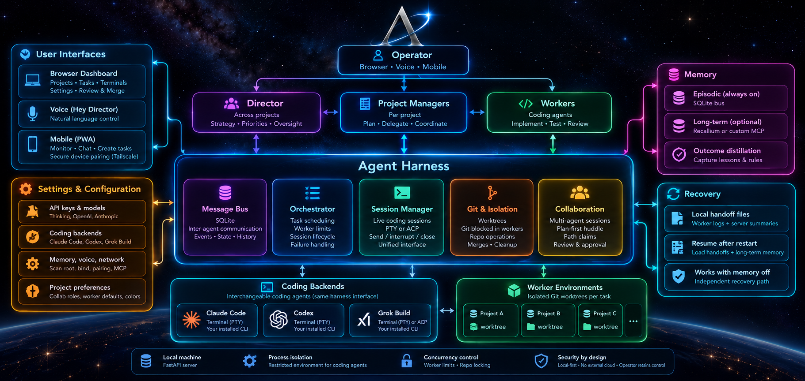
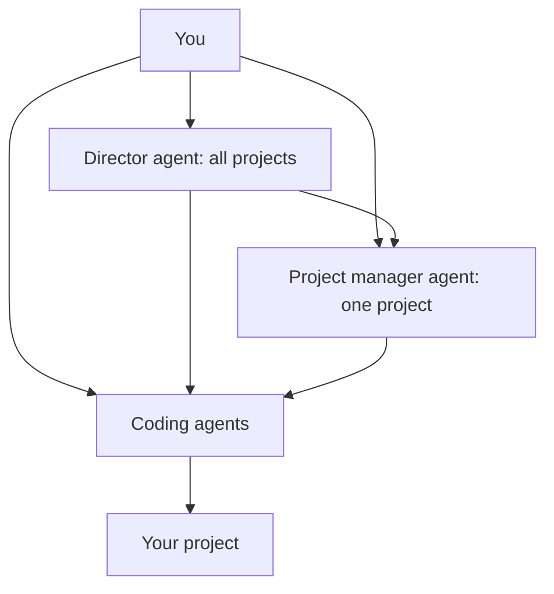

# Aria

**Aria is a local-first orchestrator for AI coding agents.** It brings Claude Code, Grok Build, and Codex into one workspace, with a live canvas, collaborative workflows, and project memory across sessions.

 

Windows 10 or 11 (64-bit), about 70 MB. macOS 11 or later on Apple silicon (M1 or newer), about 65 MB.

> **Early test version.** Aria runs coding agents that can change files in your projects, so try it on a test project or back up important work first. Aria is not yet code-signed, so Windows and macOS will show a security warning the first time you open it. If you downloaded Aria from this official GitHub page and trust the source, the [install steps](#installing-aria) below show how to open it.

> **This repository is a sample, not the full program.** It contains an overview of Aria, design documents, and a few small, self-contained pieces of its code. The full Aria application is private and is not open source.

## What Aria does

**Runs every major coding agent in one workspace.** Everything happens on a canvas. Open terminals in any of your projects and run Grok Build, Claude Code, or Codex in them. You can keep many sessions open across many projects at once, limited only by your computer's resources. Tasks Aria runs have a separate cap, 12 at a time by default, which you can change in Settings. Each terminal is live and tethered to its project on the canvas, and you can open any file in a Monaco editor window when you need it.

**Coordinates multiple agents on one task in Collab mode.** You can work with any coding agent on its own, or put two or all three of them into Collab mode on a single task. Collab mode puts the agents on one isolated copy of the project and gives each one a role: one implements the product code, one writes the tests, and one handles the glue code and reviews the work. You decide which agent takes which role. Before anyone writes code, the agents agree on a plan, and Aria turns down every request to start editing files until the reviewing agents accept it. After that, each agent stays in its role: only the implementer writes product code, the test agent writes only tests, and the review agent writes only glue code and documentation, never product code. The agents coordinate through a shared message bus, and you can follow every exchange as it happens.

**Adds a management layer of thinking agents.** Above the coding agents is a management layer of agents that do not write code. They plan, coordinate, and direct. A director agent oversees every project and takes your instructions by voice or text. Each project has its own project manager agent that knows that codebase, plans changes, creates tasks, and dispatches them to the coding agents. The director agent and the project manager agents message each other over the same bus, and you can talk to any of them at any time.

**Isolates every task, or works in place with a snapshot.** Each task runs in one of two modes. By default, a task is isolated: the coding agent works in its own git worktree, a separate copy of the code on its own branch. Because each task has its own copy, many isolated tasks can run in the same folder at once without touching each other's files. Git is removed from the agent's environment in this mode, Aria commits the agent's work, and you choose to merge it or discard it. You can also run a task in place: the coding agent edits the real files directly, and Aria takes a snapshot first, so you can undo that one task without touching anyone else's changes. Because in-place tasks modify shared files directly, Aria permits only one active in-place task per folder to prevent conflicting writes. (A project in Aria can span several folders, so a project can have an in-place task running in each of them.)

**Works hands-free and from your phone.** The director agent and every project manager agent respond to a wake phrase, so you can give instructions by voice without touching the keyboard. With xAI or OpenAI voice, the audio runs through Aria's own local relay, so your API key never reaches the browser. You can also pair your phone through a one-time invitation. A paired phone can follow progress, chat with the director and project manager agents, talk to the coding agents, and create and run tasks, whenever it can reach the computer Aria runs on.

**Remembers what it learns.** Aria's memory is a hybrid:

- **Semantic memory:** long-term knowledge of your projects, kept in Recallium over MCP by default. You can point Aria at your own memory server instead, as long as it offers the same memory tools as Recallium, or turn semantic memory off.
- **Episodic memory:** Aria's own always-on record of everything said and done, kept on its SQLite message bus. It stays on even when semantic memory is off.
- **Memory distillation:** when semantic memory is on, Aria regularly turns the recorded outcomes of finished tasks into lessons and standing rules (procedural memory) that later tasks draw on.

The result is an orchestrator that keeps what it learns about your projects and, when semantic memory is on, uses lessons from finished tasks to guide future work. When Aria shuts down, every coding agent writes a handoff note, so the next session resumes where the last one stopped, even with long-term memory turned off.

## Architecture at a glance

## How you work with it

Arrows show who can direct whom. You can give instructions to the director agent, to any project manager agent, or directly to the coding agents. The director agent can direct the project managers and the coding agents, and each project manager agent directs its coding agents. The agents answer and report back along the same paths, so nothing here is a one-way conversation. A coding agent's work reaches your project last: in isolated mode, its changes land only after you accept them.

## Built with

- **Python and FastAPI** for the local backend.
- **WebSockets**, so the screen updates live while work is happening.
- **SQLite in WAL mode**, so the screen can keep reading while Aria saves new data.
- **xterm.js** for the live terminals, backed by ConPTY on Windows and ptyprocess on macOS.
- **The Monaco editor**, the same editor that powers VS Code.
- **Git worktrees**, which give each task its own copy of the project.
- **A local voice relay** for xAI and OpenAI voice, so your API key never reaches the browser.
- **An installable phone web app** for following along on your phone.
- **MCP** (Model Context Protocol), a standard way for other programs to connect to Aria.

## Design documents

These documents explain how parts of Aria are designed and why. They describe the problems each part solves and the reasoning behind each decision, without including the private implementation.

- [Architecture](docs/architecture.md): the director, the project managers, and the workers, and how a request becomes finished work.
- [Isolation](docs/isolation.md): why each task gets its own copy of the project, and why workers are not allowed to run git.
- [Messaging](docs/messaging.md): how the parts of Aria talk to each other, and why a web page cannot impersonate the director.
- [Phone pairing](docs/phone.md): how a phone connects securely, without a password in the QR code.
- [Scheduling](docs/scheduling.md): how tasks wait their turn, and how Aria makes sure two workers never claim the same task at the same time.
- [Engineering practice](docs/engineering.md): how the samples are checked, and how this repository is checked before it is published.
- [Trade-offs](docs/tradeoffs.md): the main design choices, and the simpler options that were rejected.

## The code samples

Each folder in `samples/` contains a small, self-contained rewrite of one part of Aria, with its own README and its own test. The samples do not need the rest of Aria to run, and every test runs automatically on Windows and macOS through GitHub Actions.

- [`samples/message_bus`](samples/message_bus): an append-only message bus with live delivery, history for late readers, and HMAC-authenticated sender names that cannot be forged.
- [`samples/task_scheduler`](samples/task_scheduler): a SQLite task queue in which claiming a task is a single atomic step, so two workers can never take the same task at once, with a limit on running tasks and recovery from lost workers.
- [`samples/git_lockdown`](samples/git_lockdown): a git worktree per task, and a rebuilt worker environment in which git is refused.
- [`samples/phone_pairing`](samples/phone_pairing): one-time phone pairing with expiring, single-use invitations and no secret in the QR code.
- [`samples/terminals`](samples/terminals): live pseudo-terminal sessions on Windows (ConPTY) and macOS behind one interface.
- [`samples/folder_picker`](samples/folder_picker): a folder browser that shows folder names only, and refuses any request that does not come from your own computer, including requests from other websites open in the same browser.
- [`samples/worker_interface`](samples/worker_interface): the common interface that every coding worker must implement.

## What is not included

This repository does not include the full application. It does not include the instructions the director and project managers follow, how they plan and assign work, or how collaboration mode, memory, and memory distillation work.

## Installing Aria

> **Before your first session:** Aria runs coding agents that can change files in your projects. While Aria is in early testing, try it on a test project or back up important work first.

Aria is not yet code-signed, so Windows and macOS will show a security warning the first time you open it. If you downloaded Aria from this official GitHub page and trust the source, the steps below show how to open it.

**Windows**
1. Run AriaSetup-0.2.0-alpha.13.exe.
2. When Windows SmartScreen says "Windows protected your PC", select **More info**, then **Run anyway**.
3. Open Aria from the Start menu and follow the setup.

**Mac**
1. Open Aria-0.2.0-alpha.13-mac.dmg and drag Aria into Applications.
2. Open Aria. macOS will say it can't verify the app. Click **Done** (or **OK**).
3. Open **System Settings**, go to **Privacy & Security**, scroll down, and click **Open Anyway** next to the message about Aria. Then open Aria again and follow the setup.

## License

Copyright (c) 2026 Colin M. Skinner. All rights reserved. This repository is published so that people can read it; no permission is given to copy, modify, or reuse any part of it. See [`LICENSE`](LICENSE).
