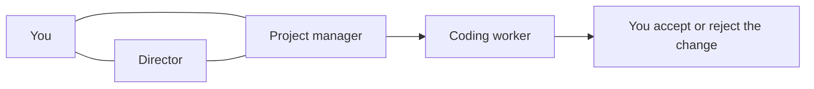

# Architecture

This page describes the overall structure of Aria. It is a design overview, not a setup guide, and it does not cover the full program.

## Overview

Aria is local-first: it runs on your own computer, next to the projects it works on. Your project stays on that machine; only what an AI service needs for a given request is sent to it. The interface runs in a browser window, and the local Aria program sits between that window and the coding workers.

Aria is organized around three roles:

- **The director** oversees all of your projects. You tell it what you want done, on any project, and it coordinates the work. It can ask any project manager for status, ask it questions, or tell it to start work.
- **A project manager** is responsible for one project and knows that codebase. You can talk to a project manager directly, and the director talks to it as well. When code needs to change, the project manager turns the request into tasks.
- **A coding worker** carries out one task. Each worker is an existing AI coding assistant (Grok Build, Claude Code, or Codex) that Aria starts and directs.

You can ask the director or a project manager a question without starting any work. Only a request to change code becomes a task.

When you ask for a change, the work follows four steps:

1. You describe the change, by voice or by text, to the director or directly to a project manager.
2. The project manager creates tasks for that project.
3. A coding worker carries out each task, usually in its own separate copy of the project.
4. You review the finished work and decide whether to merge it.

Lines are conversations. Arrows show work being carried out.

## Why the roles are separate

When a single AI model is asked to both decide the work and change the files, it tends to drift away from the plan as it goes. Aria keeps those jobs apart, so a plan can be read before any file changes, and so asking a question about a project never changes the project by accident.

- The director is how you run all of your projects from one place.
- The project manager is the authority on one project: it answers questions about it and owns its task list.
- Each worker owns one task and the files that task changes.
- You own the final decision to merge.

The separation also keeps mistakes small. A bad change made in a task's own copy of the project stays in that copy. It does not alter the plan, and it does not reach the rest of your project unless you accept it.

## Where state lives

Each task is stored as a row in a local SQLite database, and that row is the single source of truth about the task. The message bus is a record of what was said, not of whether work has started. The scheduler, the screen, and a worker that starts late all read the same rows. SQLite runs in WAL mode, so the screen can keep reading while a task is being updated.

If a worker stops unexpectedly, its task does not stay stuck. When no live session remains for a running task, the task goes back to waiting. [Scheduling](scheduling.md) and [Isolation](isolation.md) describe those rules in more detail.

## What this page leaves out

The instructions the director, the project managers, and the workers follow are private, and so is the logic that decides when a plan is ready to act on. Collaboration mode, memory, and memory distillation are also private and are not described in these documents.
