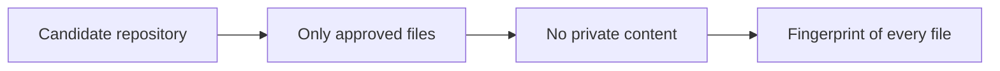

# Engineering practice

This page describes how the code samples are verified, and the checks this repository must pass before it is published.

## Automated checks

Each code sample comes with its own Python check in the same folder. The checks do not start the full program and do not need a network connection. Every check runs automatically on Windows and macOS through GitHub Actions whenever the repository changes.

- **Message bus:** live delivery, history replay, and rejection of forged or borrowed sender tokens.
- **Task scheduler:** eight threads race to claim twenty tasks, and every task must be claimed exactly once. The cap, the folder rule, and recovery from lost workers are also checked.
- **Git lockdown:** a real temporary repository and worktree, with git refused by name in the worker's environment.
- **Phone pairing:** single use, expiry, the attempt limit, and an approval code that never appears in the QR payload.
- **Terminals:** a real pseudo-terminal session whose output is read back.
- **Folder picker:** only folders are listed, never file names or contents, and requests that do not come from the same computer are refused.
- **Worker interface:** a missing program and a missing login are both reported correctly.
## Checks before publishing

Before anything in this repository is published, it has to pass three automated checks:

1. **An approved file list.** The check fails if the repository contains any file that is not on the agreed list.
2. **A private-content scan.** The check fails if any file contains material that must stay private, such as names that identify private work.
3. **A fingerprint.** A hash is calculated over the exact contents of every file. The same files always produce the same fingerprint, so the version that was reviewed and approved is provably the version that was published. If even one byte changes, the fingerprint changes and the review has to be repeated.

Two reviewers run these checks independently, and a version is published only when both get identical results.

## Platforms

Aria runs on Windows and macOS. The samples avoid platform-specific code except where a feature genuinely differs between systems. For example, the folder picker lists drive letters on Windows and the filesystem root on macOS. The checks cover the behavior that is the same on every system.

## What this page leaves out

The list of terms used by the private-content scan is itself private, because publishing it would reveal the names it is designed to protect.
