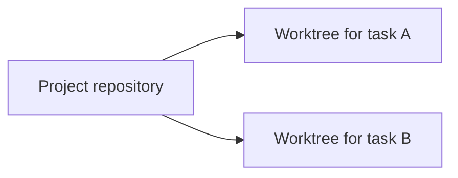

# Isolation

When two tasks edit the same copy of a project at the same time, they overwrite each other's work. Aria prevents this by giving every task its own copy.

## The problem

A coding task is a set of file changes, together with a claim that those changes complete the task. If two tasks share one working copy, whichever saves last wins. The first task's test results no longer describe the files on disk, and nobody can tell which change belonged to which request.

## The design

Most tasks are isolated. Each isolated task gets its own git worktree: a separate working copy of the same repository, on its own branch, with its own files and its own staging area. The worker for that task can only see and change that worktree. Several isolated tasks can run on the same folder at the same time, because none of them edits the live files.

Some work has to change the live files directly; Aria calls this in-place work. The scheduler allows only one in-place task per folder at a time, so two of them can never overwrite each other. In-place work is the exception, and all parallel work is isolated.

Isolated workers are not allowed to run git. When Aria starts a worker, it gives that worker a modified environment, while Aria's own environment stays unchanged. Git's directories are removed from the worker's `PATH`, a small stand-in program that refuses to run is placed first on `PATH`, and `GIT_EXEC_PATH` points to that stand-in, so git cannot load its helper programs. A worker that calls git by name is refused.

This rule exists because all the worktrees share a single `.git` directory. A worker that ran `git fetch` or `git checkout` could damage the live tree, not just its own copy. Telling the worker not to run git was not reliable enough, so the command is removed.

The lockdown is one layer of defense, not complete isolation: commands built directly into the git executable can still run if a worker calls git by its full path. That is why Aria does not depend on it alone. Aria makes every commit itself, and it merges a task's changes only after you accept them. The [git lockdown sample](../samples/git_lockdown) shows the environment rebuild and its limits.

Within each repository, Aria creates, removes, and merges worktrees one at a time. Workers can edit files in parallel, but changes to the shared `.git` directory never happen at the same time.

A worktree lives in its own directory, which makes every file path inside it longer. On Windows, that extra length can push a deeply nested file past the old 260-character path limit, and creating the worktree then fails. Aria runs git with long paths enabled to prevent this. On macOS, which has no such limit, the setting has no effect.

## Benefits and costs

Tasks can run in parallel without interfering with each other, and a failed task can be thrown away without undoing anyone else's work. The cost is extra bookkeeping: every task needs its own worktree, and finished work has to be merged back. Aria accepts that cost deliberately. A single shared copy would be simpler, but it stops working the moment two tasks run at once.

## What this page leaves out

This page does not cover how worktrees are created, how merge conflicts are resolved, or how Aria rejects a bad change. Those parts are private.
