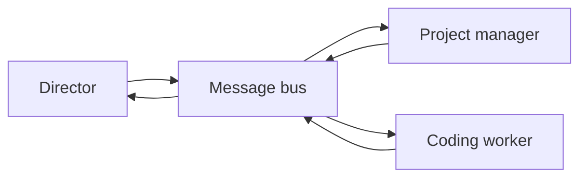

# Messaging

The director, the project managers, and the coding workers need to communicate with each other. (The roles are described in [Architecture](architecture.md).) They run as separate processes, and the browser window that shows their conversation is not one of them.

## The problem

A simple approach would be for each part to write messages into shared files. That approach has two serious flaws. A part that starts late can miss messages that were sent before it started. Worse, a web page could write a message that claims to come from the director. Both failures look like ordinary conversation, which makes them dangerous when the next step is changing code.

## The design

All communication goes through a single message bus. Every message records who sent it and what it says. Parts that are listening receive each message the moment it is published. The bus also keeps a history of the conversation, so a worker that starts after the plan was written can read the plan instead of guessing at it.

Much of this conversation has nothing to do with a running task. The director asks a project manager for status, passes on an instruction from you, or asks a question about a codebase, and the project manager answers. You can also talk to a project manager directly.

## Who is allowed to speak as whom

The name on a message is not proof of who sent it. Anything outside the Aria process, including the browser, can put any name on a message. So Aria only accepts a privileged name, such as the director, a project manager, or a worker, when the sender also presents a token that Aria itself issued for that exact name. Without a matching token, the message is stored as coming from an ordinary outside caller. The secret used to issue tokens never leaves the Aria process.

This matters because the browser is the least trusted part of the system: it is where a malicious script would run if one were ever pasted in.

## Housekeeping

The bus only ever adds messages; it never edits them. Old messages are cleaned up by a separate background job, not by the scheduler, so a slow or failed cleanup can never delay or stop new work.

## What this page leaves out

This page does not cover the message format or the rules about which part may say what to whom. Those parts are private.
