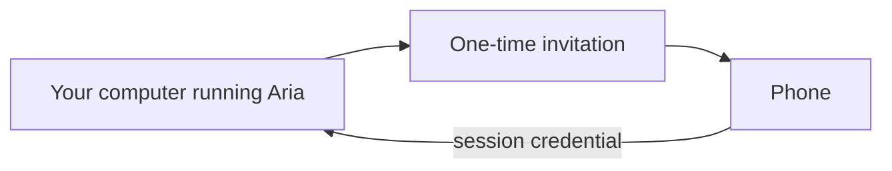

# Phone pairing

Aria runs on your computer, and a paired phone acts as a second screen for the same session. The phone does not hold a copy of your project, and pairing it does not open Aria to the rest of the network.

## The problem

Aria has to be sure that a phone was actually invited before it lets the phone in. Two obvious approaches fail:

- **Putting a password in the QR code.** A QR code is just a picture. Pictures are easy to screenshot and share, and anyone who sees the picture would have the password.
- **Opening Aria to the local network.** Anyone else on the same Wi-Fi network could then reach it. Being on the same network does not prove that someone is the person sitting at the computer.

## The design

Pairing uses a one-time invitation. The QR code identifies the invitation but does not contain a password. When the phone accepts the invitation, it receives its own credential for that session, and the invitation cannot be used again.

By default, Aria only accepts connections from the computer it runs on (this is called binding to loopback). No phone can connect until an invitation has been created.

Accepting only local connections by default means that a configuration mistake fails safely. If a firewall rule is missing, the session is still not exposed, because Aria was never listening on the network in the first place. Reaching a phone that is somewhere else is a separate step that you have to choose to take.

## What this page leaves out

This page does not cover the invitation format, the credential, or the network setup that connects the phone. Those parts are private.
