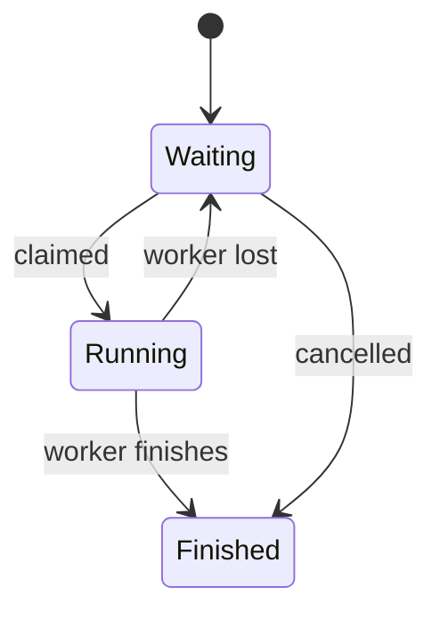

# Scheduling

A project manager's plan is a list of tasks. Aria does not start every task at once, and two workers cannot claim the same task at the same time. If a worker is lost, that task goes back to waiting and can be started again.

## The problem

Starting every task immediately would overload the computer, and it could mix together changes that were meant to happen in order. Waiting for a person to start each task by hand would waste the plan. The scheduler sits between these two extremes: tasks wait in a queue, and the scheduler starts a waiting task whenever a worker slot is free.

## The design

Task state lives in SQLite. Taking a task off the queue, called claiming it, is a single database update: the oldest waiting task that is allowed to run is switched to running in one statement. Because the database does this in one step, two parts of the program can never claim the same task.

Before a task can be claimed, the scheduler checks that it is safe to run. For example, tasks that work in their own copy of the project can run side by side on the same folder, but only one task at a time may edit a folder's live files directly. See [Isolation](isolation.md).

A limit controls how many workers run at the same time. The scheduler wakes up as soon as new work is queued, and it also checks on a timer, so a missed signal cannot leave the queue stuck. If one pass of the scheduler fails, the next pass still runs.

If Aria restarts, or a worker stops unexpectedly, any running task without a live session goes back to waiting and is started again later. Without this, stuck tasks would fill every worker slot and nothing new would ever start. The cost is that a task interrupted this way can run a second time, so atomic claiming guarantees one worker per task at a time, not that each task runs exactly once.

The key engineering point is that claiming is atomic. Without that guarantee, "waiting" would only be a label, and two parts of the program could each start the same task.

## What this page leaves out

This page does not cover the full set of rules that decide whether a task may run, or anything the scheduler does beyond starting work. Those parts are private.
